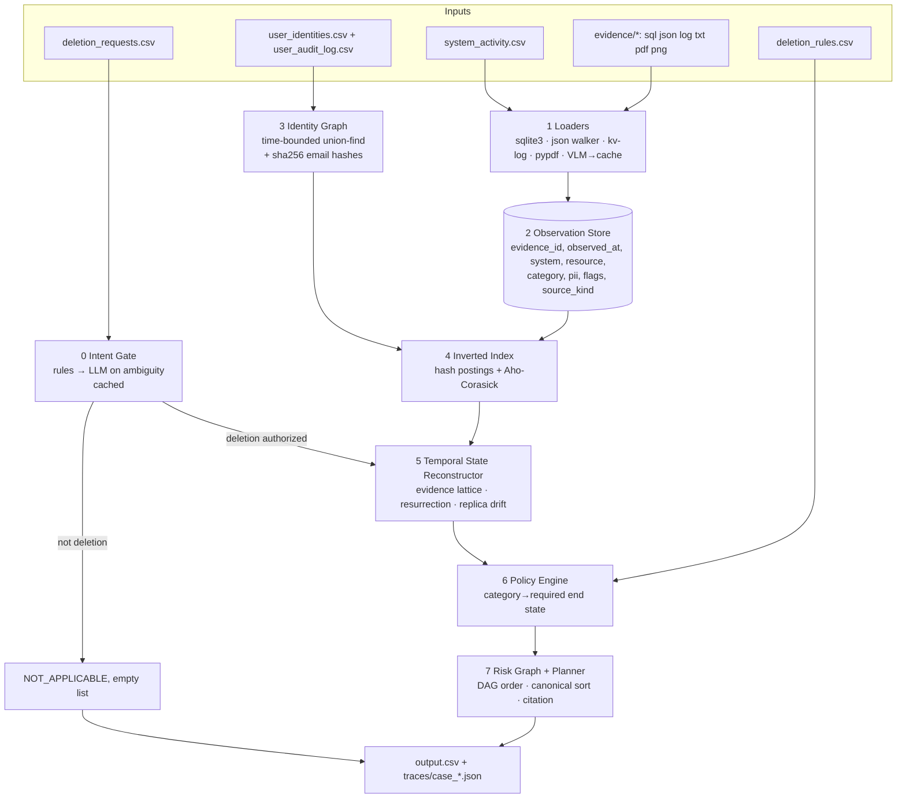

# EXORCIST: Design Document

**Provenance-Graph Deletion Auditor**, built for HackerRank Orchestrate (October 2026): *Ghost Data Still Exists*

> Ghost data is personal data whose deletion was *claimed* but never *proven*. EXORCIST finds every ghost, explains with evidence why it is still there, and writes the exact, safely ordered steps to remove it.

| | |
|---|---|
| Status | Living document. Update it whenever an architectural decision changes, and record the reason in [system.md](system.md). |
| Companion docs | [roadmap.md](roadmap.md) (progress), [system.md](system.md) (results, errors, fixes), [AGENTS.md](AGENTS.md) (agent rules, §10 = ours) |
| Entry point | `python code/main.py` writes `output.csv` at the repo root |
| Evaluation | `python code/evaluation/main.py` writes `code/evaluation/evaluation_report.md` |

---

## Table of contents
1. [Problem in one page](#1-problem-in-one-page)
2. [What the data actually looks like](#2-what-the-data-actually-looks-like)
3. [The grading contract, reverse-engineered from the samples](#3-the-grading-contract-reverse-engineered-from-the-samples)
4. [Design principles](#4-design-principles)
5. [Architecture overview](#5-architecture-overview)
6. [Component deep-dives](#6-component-deep-dives)
7. [The end-to-end algorithm for one case](#7-the-end-to-end-algorithm-for-one-case)
8. [Where AI is used, and why only there](#8-where-ai-is-used-and-why-only-there)
9. [Latency, complexity and cost](#9-latency-complexity-and-cost)
10. [Evaluation methodology](#10-evaluation-methodology)
11. [Failure modes and mitigations](#11-failure-modes-and-mitigations)
12. [Code layout](#12-code-layout)
13. [Prior art (US and China) and our differentiation](#13-prior-art-us-and-china-and-our-differentiation)
14. [Open questions](#14-open-questions)
15. [References](#15-references)
16. [Mathematical core (batch 6 upgrades)](#16-mathematical-core-batch-6-upgrades)

---

## 1. Problem in one page

Northstar Shop's deletion workflow said **"Complete"** for a customer whose data still lived in replicas, search indexes, support attachments, analytics, exports and backups. A sync job even **re-created** deleted data. Our agent must audit 518 deletion requests and, for each one:

1. Decide whether the request **actually asks for deletion**. If it doesn't, the answer is `NOT_APPLICABLE` with `[]`.
2. **Resolve identity.** The request email may be current or historical. Collect every name, email, phone and email hash the person ever had, up to `audit_at`.
3. **Reconstruct the true state** of every record and process tied to that person **as of `audit_at`**. Workflow statuses and `reported_result` values are *claims*. Only evidence is proof.
4. **Apply policy** from `deletion_rules.csv`: delete, redact, anonymize, retain, or keep a tombstone with only the stable `user_id`.
5. **Decide** the status: `COMPLETE` only if every copy is compliant, nothing can re-create the data, retained records contain only permitted identifiers, and records that must be kept still exist. Otherwise `INCOMPLETE`.
6. **Emit an ordered plan:** `FINDING` → `REMEDIATION` → `VERIFICATION`, sorted canonically, with evidence citations where the contract requires them.

Output: `output.csv` with columns `case_id,deletion_status,steps_json`, 518 rows, sorted by `case_id`.

---

## 2. What the data actually looks like

### 2.1 Tabular inputs (`dataset/`)

| File | Rows | Role |
|---|---|---|
| `deletion_requests.csv` | 518 | Cases to answer. `reported_status` breakdown: 254 COMPLETE, 152 PARTIALLY_COMPLETE, 112 NOT_STARTED. 375 unique `request_text` values. |
| `sample_deletion_requests.csv` / `sample_output.csv` | 32 / 32 | Labeled examples: 10 COMPLETE, 22 INCOMPLETE, 0 NOT_APPLICABLE. |
| `user_identities.csv` | 850 | Current snapshot: `user_id,name,email,phone,email_hash,updated_at`. |
| `user_audit_log.csv` | 306 | Historical changes: `audit_id,user_id,event_time,field_name,old_value,new_value`. Citable as `audit_id`. |
| `system_activity.csv` | 4,011 | Global event stream: `activity_id,event_time,event_type,source_system,target_system,resource_id,reported_result,details`. Citable as `activity_id`. Mostly unrelated people. |
| `deletion_rules.csv` | 15 | Policy: `data_category,condition,required_action`. |
| `evidence_files.csv` | 94 | Manifest: `file_id,file_path,origin,captured_at`. Citable as `file_id`. Gives no case membership. |

**Activity event types:**

| Count | Event type |
|---|---|
| 890 | DELETE_RECORD |
| 672 | UPDATE_RECORD |
| 447 | SYNC_RECORD |
| 400 | INDEX_RECORD |
| 368 | SEND_EMAIL |
| 284 | REFRESH_CACHE |
| 206 | RETAIN_RECORD |
| 204 | ANONYMIZE_RECORD |
| 173 | REDACT_RECORD |
| 155 | CREATE_EXPORT |
| 89 | CHECK_DATA_FLOW |
| 36 | DISABLE_DATA_FLOW |
| 36 | BLOCK_RESTORE |
| 28 | CHECK_RESTORE_ACCESS |
| 12 | LINK_RESOURCE_IDENTITY |
| 10 | CLASSIFY_REQUEST |
| 1 | RESTORE_BACKUP |

### 2.2 Evidence corpus (`dataset/evidence/`, 94 files)

| Kind | Files | Shape | How we read it |
|---|---|---|---|
| SQL inventory snapshots | 11× `customer_data_inventory_*.sql` | Uniform schema: `snapshot_scope(origin_system, captured_at)`, `customer_profiles`, `customer_search_documents`, `customer_analytics_profiles`, `support_records`, `customer_exports`, `connector_subscriptions(enabled)`, `backup_restore_entries(restore_allowed)`, `security_audit_records(retention_until)` | `sqlite3.connect(':memory:').executescript()`, then `SELECT *` per table |
| SQL replica captures | read (5), regional (3), reporting (2), failover (2), search primary (1) | `customer_data_primary` vs `customer_data_*_replica`; `customer_profiles_primary` vs `_failover_replica`; `search_documents_primary` | Same; **each replica table is its own observation source**, so drift between them is visible |
| JSON snapshot bundles | 12× `customer_data_snapshot_bundle_*.json` | `{exported_at, snapshots:[{captured_at, data_store, collection, records:[…]}]}` | Recursive walker; `data_store` → `system_id` |
| JSON service exports | 11× `service_resource_export_*.json`, plus analytics report, export jobs/manifest, connector configs, security ledger | Per-service resource dumps | Same walker with per-collection adapters |
| Logs | 11× `resource_lookup_trace_*.log` (readback), observability/syslog/trace exports, `support_replica.log`, `notification_delivery_*.log`, `search_index_diagnostic_*.log` | `key=value` lines; readbacks emit `*_read_completed resource_id=… enabled=… email=…`, notification logs emit `result="FOUND"/"NOT_FOUND"` | One compiled tokenizer regex; event normalizer |
| Text record | `customer_account_handover_20261001.txt` | Free-text handover | Aho-Corasick mention scan, plus a light structured parse |
| PDFs | 4 (account history, delivery correction attachment, legal retention register, security retention extract) | Business documents | `pypdf` text, then kv/table parse; VLM fallback if image-only |
| Images | 11 PNG dashboards (connector console, backup restore console, search inspector, admin console, …) | Real facts in UI tables, e.g. `data_flow_1121 · customer_analytics_warehouse · selector jain.aditi@gmail.com · Continuous` | VLM once → strict JSON → cached |

### 2.3 System and resource vocabulary (from the samples)

| `system_id` | `resource_id` prefix | Policy category |
|---|---|---|
| `account_service` | `account_` | USER_PROFILE → DELETE |
| `search_service` | `search_` | SEARCH_INDEX_ENTRY → DELETE |
| `support_platform` | `support_` | SUPPORT_ATTACHMENT → DELETE, **or** SUPPORT_MESSAGE → REDACT |
| `analytics_platform` | `analytics_` | ANALYTICS_PROFILE → ANONYMIZE (but see §14, Q1) |
| `export_service` | `export_` | USER_EXPORT → DELETE |
| `integration_service` | `data_flow_` | active data flow → DISABLE |
| `backup_service` | `backup_` | BACKUP_ARCHIVE → RETAIN + BLOCK_RESTORE |
| `security_service` | `audit_record_` | SECURITY_AUDIT_LOG → RETAIN (VERIFY_PRESENT) |
| `identity_service` | `tombstone_` | ACCOUNT_TOMBSTONE → REDACT to `user_id` only |

Other categories in the rules (CACHE_ENTRY, SECONDARY_IDENTIFIER, PRODUCT_TELEMETRY, MARKETING_PROFILE, EMAIL_DELIVERY_LOG, LEGAL_HOLD_RECORD) may appear in the 518 test cases. The category map is **data-driven** and must be extended as we discover them. All extensions are logged in [system.md](system.md).

---

## 3. The grading contract, reverse-engineered from the samples

These patterns hold across all 32 labeled samples. They are the most valuable facts in this document.

1. **Canonical ordering = (phase rank, operation rank, `system_id`, `resource_id`)**, with operation rank taken from the problem statement's table order:
   - FINDING: `REPORT_REMAINING_RECORD` < `REPORT_EXPOSED_PII` < `REPORT_ACTIVE_DATA_FLOW` < `REPORT_RESTORE_RISK`
   - REMEDIATION: `DISABLE_DATA_FLOW` < `BLOCK_RESTORE` < `DELETE_RECORD` < `REDACT_RECORD` < `ANONYMIZE_RECORD`
   - VERIFICATION: `VERIFY_RECORD_ABSENT` < `VERIFY_RECORD_PRESENT` < `VERIFY_RECORD_REDACTED` < `VERIFY_RECORD_ANONYMIZED` < `VERIFY_DATA_FLOW_DISABLED` < `VERIFY_RESTORE_BLOCKED`
   - Example (case_11): VERIFY order is `account_service` (ABSENT), `search_service` (ABSENT), `security_service` (PRESENT), `support_platform` (REDACTED), `analytics_platform` (ANONYMIZED), `integration_service` (DISABLED).
   - String sort applies to `resource_id`. This needs confirming on multi-resource ties of the same op and system; see §14.
2. **Verification covers the full required end state of *every relevant resource*, not only the remediated ones.** INCOMPLETE cases still verify `account_service … VERIFY_RECORD_ABSENT` even when the account was already gone, and always `security_service audit_record_* VERIFY_RECORD_PRESENT` when a retained audit record exists.
3. **Findings exist only for violations.** A compliant resource gets no finding and no remediation, but it does get a verification step.
4. **Every finding produces exactly one remediation and one verification:**

   | Finding | Remediation | Verification |
   |---|---|---|
   | REMAINING_RECORD | DELETE_RECORD | VERIFY_ABSENT |
   | EXPOSED_PII (redact category) | REDACT_RECORD | VERIFY_REDACTED |
   | EXPOSED_PII (anonymize category) | ANONYMIZE_RECORD | VERIFY_ANONYMIZED |
   | ACTIVE_DATA_FLOW | DISABLE_DATA_FLOW | VERIFY_DATA_FLOW_DISABLED |
   | RESTORE_RISK | BLOCK_RESTORE | VERIFY_RESTORE_BLOCKED |

5. **Evidence citation:**
   - Findings cite the file that *observed* the violation, typically the **latest direct observation at or before `audit_at`** that contains the resource. For example, `evidence_92` (2026-09-15 export) is cited by every case audited on 2026-09-15 whose resources appear there.
   - COMPLETE cases: every verification step cites the proving evidence. Different resources may cite different files (case_04 cites `evidence_54` for the account and `evidence_56` for analytics).
   - INCOMPLETE cases: remediation and verification steps use `""`.
6. **`reported_status` is uncorrelated with truth.** case_25 is `NOT_STARTED` but truly COMPLETE; case_05 is reported `COMPLETE` but truly INCOMPLETE.
7. **Only resources that belong to the subject count.** Global files contain many decoys, so a resource is relevant only if it links to the subject's identity cluster (§6.3).
8. **Replicas matter.** case_16 finds `account_994` still alive in a **read replica** (`evidence_05`).

---

## 4. Design principles

| # | Principle | Consequence |
|---|---|---|
| P1 | **Deterministic core, AI at the edges** | Every scored decision (state, policy, ordering, citation) is pure code that can be unit-tested. Models only read human language and pixels. |
| P2 | **Compile once, query many** | One pass converts the whole corpus into an in-memory Observation Store. Each case is then hash lookups, not file scans. |
| P3 | **Evidence beats claims** | An evidence-strength lattice decides state; `SUCCESS` only matters when nothing stronger contradicts it. |
| P4 | **Time is first-class** | Every fact carries `observed_at`. A case sees only facts with `observed_at ≤ audit_at`. Cited evidence must satisfy `captured_at ≤ audit_at`. |
| P5 | **Every step carries its why** | Each derived step stores its provenance set (why-provenance, Green et al. PODS 2007). That gives us the `evidence_id` and an explanation trace per case (`--explain`). |
| P6 | **Rules are data** | `deletion_rules.csv` and the category map are loaded, never hardcoded. Nothing is keyed by `case_id`. |
| P7 | **Byte-identical reruns** | Fixed sort keys, fixed JSON key order (`separators=(',',':')`), no set-iteration order leaks, model temperature 0, content-hash caches. |
| P8 | **Measure before believing** | No change is "an improvement" until `evaluation/main.py` shows it, and the result is logged in system.md. |

---

## 5. Architecture overview



Data contracts between stages:

```python
@dataclass(frozen=True)
class Observation:
    evidence_id: str          # file_id | activity_id | audit_id
    observed_at: datetime     # snapshot captured_at / log line ts / activity event_time
    system_id: str            # account_service, search_service, ...
    resource_id: str          # account_994, data_flow_1770, ...
    table: str                # source table/collection (drives category + replica identity)
    source_kind: str          # snapshot | readback | screenshot | document | activity_claim
    present: bool | None      # row exists / FOUND / NOT_FOUND
    pii: dict[str, str|None]  # name, email, phone, email_hash, customer_reference/user_id
    flags: dict[str, Any]     # enabled, restore_allowed, retention_until, account_status, ...

@dataclass
class ResourceState:          # output of stage 5, per (system_id, resource_id)
    exists: bool
    exposed_fields: set[str]  # prohibited identifiers still present
    active_flow: bool
    restore_open: bool
    proof: list[str]          # evidence ids supporting this state (why-provenance)
```

---

## 6. Component deep-dives

### 6.0 Intent Gate: a cascade classifier

**Goal:** `authorizes_deletion: bool` per request, across languages.

| Tier | Mechanism | Latency | When it decides |
|---|---|---|---|
| T1 | Multilingual lexicon: deletion verbs (`delete, erase, remove, close my account, eliminar, borrar, supprimer, suppression, löschen, cancellare, excluir, 删除, 削除, 삭제…`) and **override intents** (access/copy, invoice, export/download, correct/update, unsubscribe/opt-out, "keep/leave my profile") | ~µs | Clear positive (deletion verb, no override) or clear negative (override, no deletion verb) |
| T2 | Small LLM with constrained JSON output `{authorizes_deletion, intent, language, rationale}`, temperature 0 | ~300 ms, cached | Mixed or unknown-language texts |
| T3 | Disagreement handling: if T1 is confident and T2 disagrees, log to `system.md` for review | none | Development only |

Important nuances:
- "Close my account" and "remove my profile" count as **deletion**.
- "Stop sending marketing emails" is **NOT_APPLICABLE**. It is not a deletion of the account, even though MARKETING_PROFILE is a deletion category.
- "Delete my account but keep anonymous statistics" is still **deletion** (case_04).
- The cache key is `sha256(normalized_text)`. With 375 unique texts, at most 375 calls are ever made, and usually far fewer because T1 resolves most.

### 6.1 Loaders

One adapter per format. All adapters emit `Observation` rows and never make decisions.
- **SQL:** run each file in its own `:memory:` DB. `observed_at` is `snapshot_scope.captured_at` (per origin system) or else the manifest `captured_at`. Replica tables (`customer_data_read_replica`, `…_failover_replica`, `…_replica_eu_west`) are tagged with a `replica` attribute so drift is preserved.
- **JSON:** walk `snapshots[]`. `data_store` maps to `system_id` and `collection` maps to `table`. Unknown shapes are logged, never silently dropped.
- **Logs:** a regex `(\w+)=("[^"]*"|\S+)` turns each line into a dict.
  - `*_read_completed` / `record_lookup` lines become `readback` observations (`result=NOT_FOUND` → `present=False`).
  - `*_read_started lookup_key=` lines only link identity to a resource. They are not state.
- **PDF:** `pypdf` text, then the same kv/table heuristics. If the extracted text is under 50 characters, fall back to the VLM.
- **PNG:** a VLM prompt that returns `{"rows":[{"system_id","resource_id","identifiers":[],"status_flags":{}}]}`. The result is cached in `code/cache/vlm/<sha256>.json`. Extraction happens once and the cache is committed, so reruns are deterministic and free.
- **Activity CSV:** each row becomes an `activity_claim` observation for its target system and resource (plus `source_kind=activity_claim`). `LINK_RESOURCE_IDENTITY` rows become identity edges.

### 6.2 Observation Store

A list of `Observation` rows plus three indexes:
- `by_resource[(system_id, resource_id)] → [obs…]` sorted by `observed_at`
- `by_identifier[value] → {(system_id, resource_id)}` (postings)
- `by_evidence[evidence_id] → [obs…]` (for citation and explain)

### 6.3 Identity Graph: time-bounded union-find

- **Nodes:** `user:<id>`, `email:<lower>`, `phone:<digits-only E.164-ish>`, `name:<casefold>`, `hash:<sha256 hex>`.
- **Edges**, valid as of `audit_at`:
  - `user_identities.csv`: the current values. Their validity ends when the snapshot `updated_at` passes the case window, but they are usually valid.
  - `user_audit_log.csv`: `old_value` and `new_value` both connect to `user_id`, if `event_time ≤ audit_at`.
  - Computed `sha256(email)` for every known email, so rows that carry only a hash still match.
  - Activity `LINK_RESOURCE_IDENTITY` rows and `customer_reference` / `user_id` columns in evidence link resources to users.
- **Algorithm:** union-find with path compression and union by rank, amortized `O(α(n))`.
- **Safety:** a user node never merges with another user node. A shared or reused identifier that would bridge two users is recorded as **ambiguous** and resolved by time: whoever owned it at the observation time wins.
- **Matching strength:**
  - **Strong:** `customer_reference`/`user_id` equals the subject, or an exact email or hash match.
  - **Medium:** a phone match. A name match is accepted only together with a second signal.
  - **Weak (never alone):** name only.

### 6.4 Inverted index + Aho-Corasick

- Structured columns go to hash postings, with O(1) lookups.
- Unstructured text goes through **one Aho-Corasick automaton built over all identifiers of all 850 users**: logs, PDF text, TXT handover, support `message_excerpt`, and VLM text. A single pass gives every `(identifier, file, offset)` mention in `O(N + M + z)`.
- In Python we use `pyahocorasick` (a C extension). The fallback is a pure-Python implementation of the same algorithm.
- Scale-out note: at production scale, a per-shard **cuckoo filter** (Fan et al. 2014) pre-filters shards that cannot contain an identifier. It supports deletion, unlike Bloom filters. We document this but don't need it for 94 files.

### 6.5 Temporal State Reconstructor

For each candidate resource of the subject, we take `obs[observed_at ≤ audit_at]` and compute state with the **evidence-strength lattice**:

```
4  direct observation: snapshot row present/absent, readback FOUND/NOT_FOUND,
                       screenshot row, document row
3  confirmed operation: activity claim followed by an agreeing direct observation
2  activity claim     : DELETE/REDACT/ANONYMIZE/DISABLE/BLOCK with reported_result
1  workflow claim     : request.reported_status
```

**Rule: latest observation among the highest available tier wins. A lower tier never overrides a later higher tier.** Specifically:
- A `DELETE_RECORD SUCCESS` claim at t1, followed by a snapshot at t2 > t1 that still contains the row, gives **PRESENT**. This is the classic ghost.
- A **resurrection** is `DELETE` at t1, then `SYNC_RECORD`/`RESTORE_BACKUP`/import at t2, then an observation at t3 showing the row. It is reported as a remaining record. If the source flow is still enabled, it is also reported as `REPORT_ACTIVE_DATA_FLOW`.
- **Absence proof:** a resource counts as absent only if a direct observation at or before `audit_at` shows it absent. Examples are a readback `NOT_FOUND`, or a snapshot of that system and table, captured after the delete, that lacks the row. The snapshot's scope must cover that system; an empty table outside scope proves nothing.
- **Replica drift:** each `(system, replica)` pair is evaluated separately. Any replica still holding PII makes the resource non-compliant.

Derived flags:
- `active_flow = connector enabled == 1 (or "Continuous"/"enabled=true") at latest obs ≤ audit_at`
- `restore_open = restore_allowed == 1 at latest obs ≤ audit_at`
- `exposed_fields = {name, email, phone, email_hash} ∩ non-null fields` (for redact and anonymize categories)

### 6.6 Policy Engine

`deletion_rules.csv` is loaded into `{data_category: (condition, required_action)}`. A **category resolver** maps `(system_id, table, record attributes)` to a `data_category`:

| Evidence source | Category |
|---|---|
| `customer_profiles*`, `account_` | USER_PROFILE |
| `customer_search_documents`, `search_documents_primary`, `search_` | SEARCH_INDEX_ENTRY |
| `support_records` with shared or order context in `message_excerpt` | SUPPORT_MESSAGE |
| support attachment belonging only to the subject | SUPPORT_ATTACHMENT |
| `customer_analytics_profiles`, `analytics_` | ANALYTICS_PROFILE |
| `customer_exports`, `export_` | USER_EXPORT |
| `connector_subscriptions`, `data_flow_` | data flow (process, not record) |
| `backup_restore_entries`, `backup_` | BACKUP_ARCHIVE |
| `security_audit_records`, `audit_record_` | SECURITY_AUDIT_LOG, condition `retention_until ≥ audit_at` |
| `tombstone_` in `identity_service` | ACCOUNT_TOMBSTONE |

**Decision table:**

| Category action | State | Finding | Remediation | Verification |
|---|---|---|---|---|
| DELETE | exists | REPORT_REMAINING_RECORD | DELETE_RECORD | VERIFY_RECORD_ABSENT |
| DELETE | absent | — | — | VERIFY_RECORD_ABSENT |
| REDACT | exposed ≠ ∅ | REPORT_EXPOSED_PII | REDACT_RECORD | VERIFY_RECORD_REDACTED |
| REDACT | clean | — | — | VERIFY_RECORD_REDACTED |
| ANONYMIZE | linkable | REPORT_EXPOSED_PII | ANONYMIZE_RECORD | VERIFY_RECORD_ANONYMIZED |
| ANONYMIZE | unlinked | — | — | VERIFY_RECORD_ANONYMIZED |
| RETAIN (audit, legal hold) | present | — | — | VERIFY_RECORD_PRESENT |
| BACKUP (retain + block) | restore open | REPORT_RESTORE_RISK | BLOCK_RESTORE | VERIFY_RESTORE_BLOCKED |
| BACKUP | blocked | — | — | VERIFY_RESTORE_BLOCKED |
| data flow | active | REPORT_ACTIVE_DATA_FLOW | DISABLE_DATA_FLOW | VERIFY_DATA_FLOW_DISABLED |
| data flow | disabled | — | — | VERIFY_DATA_FLOW_DISABLED |

**Status:** `COMPLETE` if there are no findings; otherwise `INCOMPLETE`.

**Never-delete guard:** a RETAIN category can never produce `DELETE_RECORD`. This is asserted in code and covered by a unit test.

### 6.7 Risk Graph + Planner

- **DAG:** edges are `data_flow → target store`, `backup → restored store`, and `primary → replica/search/analytics` (from SYNC and INDEX activity).
- **Remediation order:** first cut every inbound edge (DISABLE, then BLOCK), then fix records downstream before upstream (Kahn's topological order).
  - This is the *semantic* plan. The *serialized* order is the canonical sort from §3, which already puts DISABLE and BLOCK first and is what the grader expects.
  - The DAG is kept for explanations and to validate that the canonical order never violates safety. A unit test asserts this.
- **Citation selector:** for each finding, and for each verification in a COMPLETE case, pick the proof evidence. That is the **latest direct observation ≤ `audit_at`** that establishes the state, with ties broken by `evidence_id`. The prioritization rule is tuned against the samples, and every change is logged in system.md.
- **Serializer:** `json.dumps(steps, ensure_ascii=False, separators=(',',':'))` with keys in contract order, then `csv.writer(quoting=QUOTE_MINIMAL)`. Rows are sorted by `case_id`.

### 6.8 Explain mode

`python code/main.py --explain case_18` prints, for each step:
- the provenance chain (identifier → resource → observations → lattice decision → rule → step);
- the evidence lines themselves.

This is our live demo for the AI Judge.

---

## 7. The end-to-end algorithm for one case

```text
INPUT  request r, compiled store S, identity graph G, rules R
1  if not IntentGate(r.request_text): return NOT_APPLICABLE, []
2  u      ← G.find(email:r.email, at=r.audit_at)              # subject user_id
3  ids    ← G.cluster(u, at=r.audit_at)                       # all emails/phones/names/hashes
4  cand   ← ⋃ S.by_identifier[i] for i in ids  ∪ S.by_user[u]  # candidate resources
5  for res in cand:
6      st[res] ← Reconstruct(S.by_resource[res], until=r.audit_at)   # lattice
7      cat     ← Category(res);  act ← R[cat]
8      steps  += Decide(act, st[res])                         # finding/remed/verify
9  status ← INCOMPLETE if any FINDING else COMPLETE
10 cite   ← proof evidence for findings (and verifies if COMPLETE), else ""
11 return status, CanonicalSort(steps) with step_no = 1..n
```

---

## 8. Where AI is used, and why only there

| Task | Why AI | Model class | Guardrails |
|---|---|---|---|
| Intent of `request_text` (multilingual, paraphrased) | Language understanding | small fast LLM (T2 only) | JSON schema, temp 0, cache, rules-first cascade |
| Screenshot fact extraction | Pixels → table | vision LLM | Strict schema, cached once, validated against known `resource_id` patterns |
| Scanned PDF fallback | Pixels → text | vision LLM | Used only if `pypdf` yields no text |
| *(optional)* Adjudicator for ambiguous identity links | Fuzzy reasoning | mid LLM | Off by default; only for links flagged ambiguous; logged |

**What AI never does:** decide state, apply policy, order steps, or pick citations. Those are deterministic, so they can be tested, they cost nothing to run, and they can be explained.

Provider abstraction: `code/exorcist/llm.py` talks to any OpenAI-compatible endpoint; the shipped configuration uses **Groq** (`openai/gpt-oss-20b` for the intent fallback, `qwen/qwen3.8-27b` for screenshots, ~1 s per image) and falls back to cache-only offline mode without a key. The key comes from an env var and is never committed. Token usage per call is recorded to `code/cache/usage.jsonl`, which feeds `usage_report.md`.

---

## 9. Latency, complexity and cost

| Stage | Complexity | Target wall time |
|---|---|---|
| Load + parse 94 files (SQLite in C) | O(corpus) | 1–2 s |
| Aho-Corasick build + single scan | O(N + M + z) | < 0.5 s |
| Union-find (850 users, 306 audit rows, hashes) | O(n α(n)) | < 10 ms |
| 518 cases × reconstruct + decide + plan | O(Σ postings) | < 1 s |
| Intent LLM | ≤ 375 calls cold; **0 warm** | one-time |
| VLM | 11 images cold; **0 warm** | one-time |

**Targets:**
- warm full run under **5 s**;
- cold run model spend under **$0.50**;
- **zero** model calls on reruns.

Actual measured numbers go into [system.md](system.md) and `code/evaluation/usage_report.md`.

---

## 10. Evaluation methodology

Implemented in `code/evaluation/main.py`. It writes `code/evaluation/evaluation_report.md`.

| Metric | Definition |
|---|---|
| Case status accuracy | exact `deletion_status` match, plus a 3×3 confusion matrix |
| Step-level P/R/F1 | over tuples `(phase, system_id, resource_id, operation, state)` |
| Field-level accuracy | per field over aligned steps, with `evidence_id` reported separately |
| Sequence accuracy | % of cases with an exact ordered match, plus mean normalized Levenshtein distance over step tuples |
| Exact row match | whole `steps_json` equal after JSON parse |
| Invariants (all 518 rows) | valid JSON; `step_no` 1..n; legal (phase, op, state) triples; canonical order; `""` evidence on future steps; no evidence after `audit_at`; NOT_APPLICABLE ⇒ `[]` |

**Custom evaluation cases** (≥ 3 required; we target 8+): `code/evaluation/custom_cases/` holds a mutation generator that copies a sample and injects one controlled fault, with a hand-derived expected output:

| Case | Fault | What it tests |
|---|---|---|
| C1 | Request uses the user's *old* email from `user_audit_log` | Historical identity resolution |
| C2 | A `SYNC_RECORD` after a successful delete, with a later snapshot showing the row | Resurrection |
| C3 | Tombstone still holding `email_hash` | Tombstone REDACT logic |
| C4 | A non-English request asking for an invoice copy | Intent gate → NOT_APPLICABLE |
| C5 | Violating evidence captured *after* `audit_at` | Time cutoff (must stay COMPLETE) |
| C6 | Security audit record past `retention_until` | Retention condition |
| C7 | Account deleted on primary but alive in a failover replica | Replica drift |
| C8 | `reported_result=SUCCESS` delete with no direct observation | Claim vs proof |

**Ablations** for the report, one at a time:
- no history resolution;
- trust claims (no lattice);
- ignore replicas;
- no VLM;
- intent rules only, or LLM only.

**Regression gate:** the sample score must never decrease. Every run appends a line to system.md's results table.

---

## 11. Failure modes and mitigations

| Risk | Mitigation |
|---|---|
| Decoy records with similar names | Names never match alone; require email, hash, phone or reference |
| Identifier reuse across users | Time-scoped ownership; user nodes never merge |
| Leakage from future evidence | Hard filter `observed_at ≤ audit_at` at query time; invariant check on citations |
| Unknown evidence shape | Loader logs an "unparsed" warning into system.md; coverage report lists files with 0 observations |
| VLM hallucination | Schema validation; `resource_id` must match known prefixes; cross-check against other evidence |
| LLM nondeterminism | temp 0, cached, rules-first |
| Over-reporting (false findings) | Findings need tier-4 evidence ≤ `audit_at`; precision is tracked per op |
| Ordering mistakes | Single canonical sort function with unit tests derived from samples |
| Windows/Unicode CSV issues | `encoding='utf-8'`, `newline=''` everywhere |

---

## 12. Code layout

```
<repo root>/
  AGENTS.md  design_doc.md  roadmap.md  system.md  question.md(gitignored)
code/
  main.py                    # CLI: run all cases → ../output.csv ; --explain CASE ; --samples
  exorcist/
    config.py                # paths, ranks, constants
    loaders/{sql,json_,logs,pdf,images,activity}.py
    store.py                 # Observation + indexes
    identity.py              # time-bounded union-find
    matcher.py               # Aho-Corasick + postings
    state.py                 # lattice, resurrection, replica drift
    policy.py                # rules + category resolver + decision table
    planner.py               # DAG, canonical sort, citation, serializer
    intent.py                # cascade classifier
    llm.py                   # provider abstraction + usage logging + cache
  evaluation/
    main.py                  # scorer + report writer
    custom_cases/            # mutation generator + expected outputs
    evaluation_report.md
    usage_report.md
  tests/                     # pytest unit tests (ordering, lattice, identity, policy)
  cache/                     # vlm/*.json, intent/*.json, usage.jsonl (committed except usage)
```

---

## 13. Prior art (US and China) and our differentiation

### United States
| Work | What it does | What we borrow / how we differ |
|---|---|---|
| **DELF**, Meta, USENIX Security 2020 | Deletion annotations on data types, with static and dynamic checks that deletes cascade. Found thousands of omissions across three social networks. | We borrow per-type deletion semantics (our category→action table). DELF prevents ghosts in the write path; we detect them *forensically* from exported evidence. |
| **Ethyca Fides / Fidesops** (open source) | DSR automation through connectors and an identity graph; confirms erasure with a follow-up access request. | Same identity-graph idea. We add **time-bounded history** and **resurrection detection**. A re-query cannot catch a sync that re-runs later. |
| **Microsoft Presidio** (open source) | Recognizer-based PII detection; explicitly no guarantee of full recall. | We match *known* identifiers, so exact Aho-Corasick beats NER on both recall and speed. |
| **Stripe, "Deleting Data at Organizational Scale"**, USENIX PEPR 2024 | Attribution, impact analysis, deletion propagation and orchestration. | Supports flow-first remediation. |
| **GDPRbench**, VLDB 2020 | GDPR features cause metadata explosion and large slowdowns in DBs. | Motivates compile-once metadata over per-request scans. |
| **Lethe**, SIGMOD 2020 / TODS 2023 | LSM tombstones give no bound on physical purge; adds timely, persistent deletes. | The storage-level reason "deleted ≠ gone", which is why claims ≠ proof. |
| **Intel Hyperscan / Aho-Corasick** | Single-pass multi-pattern matching (Snort IDS). | Our discovery primitive. |
| **Cuckoo filter**, CoNEXT 2014 | Deletable approximate membership; faster than Bloom filters. | Scale-out pre-filter path. |
| **"Deleted Is Not Forgotten"**, NeurIPS 2026 | LLM-agent deletion fails by *resurrection*: 93% of facts recoverable within 5 sessions. | The same failure mode as Northstar; justifies our resurrection detector. |
| **Governing AI Forgetting**, arXiv 2026 | Auditing compliance with unlearning mandates. | Same "audit, don't trust" stance. |

### China
| Work | What it does | Relevance |
|---|---|---|
| **Yang, Liu & Tao**, IJDSN 2020; **"Publicly verifiable and efficient fine-grained data deletion scheme in cloud computing"**, IEEE Access 2020 | Verifiable cloud deletion with a Merkle sum hash tree; public verifiability without a trusted third party. | The cryptographic twin of our goal. They make deletion provable *by construction*; we make it provable *from evidence*. |
| **Ant Group SecretFlow** (open source) | Privacy-preserving computation (MPC, federated learning, TEE). | Fewer copies means fewer ghosts. A preventive complement. |
| **Tsinghua China Law Review**, 2025 | PIPL erasure rights when data is absorbed into LLMs. | Derived copies are in scope, which matches our coverage of analytics, search and exports. |
| **Alibaba Cloud Data Security Center (formerly SDDP)**, **Tencent Cloud** retention terms | Commercial sensitive-data discovery; published per-service deletion windows. | Discovery exists, but no public cross-system, point-in-time completeness audit with a remediation plan. |

**The gap we fill:** existing systems either *perform* deletion (DELF, Fides), *detect* PII (Presidio, DSC), or *prove* deletion cryptographically when the storage layer cooperates (Yang et al.). EXORCIST is the missing piece: from heterogeneous, after-the-fact evidence, it decides **whether a deletion actually completed as of a point in time**. It separates claims from proof, catches resurrection and replica drift, and emits a policy-correct, safety-ordered plan with per-step provenance.

---

## 14. Open questions

Resolved answers move to [system.md](system.md).

- **Q1:** case_12 treats `analytics_9914` as **REMAINING_RECORD → DELETE**, not ANONYMIZE. Hypothesis: an analytics record with **no aggregate metrics** (pure identity copy) is a different category, perhaps PRODUCT_TELEMETRY, MARKETING_PROFILE or SECONDARY_IDENTIFIER. Alternatively, the evidence source (`service_events_ap_south` log) labels it differently. Investigate the record fields.
- **Q2:** When is support `DELETE` (attachment) versus `REDACT` (message with shared context)? Inspect `message_excerpt` and attachment markers.
- **Q3:** Which cases include `account_service VERIFY_RECORD_ABSENT`? It appears in all deletion samples, but the account resource must be discovered even when already deleted, through audit log, activity or snapshot history.
- **Q4:** Citation tie-breaking when several files at or before `audit_at` observe the same resource. Is it the latest, or the one that observes the most of the case's resources?
- **Q5:** Does `security_service` retention ever lapse (`retention_until < audit_at`)? If so, does it become a DELETE?
- **Q6:** NOT_APPLICABLE frequency in the 518: no samples exist, so the intent gate must be validated with custom cases.

---

## 15. References
- Cohn-Gordon, K. et al. *DELF: Safeguarding deletion correctness in Online Social Networks.* USENIX Security 2020. https://usenix.org/conference/usenixsecurity20/presentation/cohn-gordon
- Shastri, S. et al. *Understanding and Benchmarking the Impact of GDPR on Database Systems.* PVLDB 13(7), 2020. https://arxiv.org/abs/1910.00728
- Sarkar, S. et al. *Lethe: A Tunable Delete-Aware LSM Engine.* SIGMOD 2020; ACM TODS 48, 2023. https://disc-projects.bu.edu/lethe
- Green, T. J., Karvounarakis, G., Tannen, V. *Provenance Semirings.* PODS 2007. https://www.cs.ucdavis.edu/~green/papers/pods07.pdf
- Fan, B., Andersen, D., Kaminsky, M., Mitzenmacher, M. *Cuckoo Filter: Practically Better Than Bloom.* CoNEXT 2014. https://users.cs.utah.edu/~pandey/courses/cs6968/spring23/papers/cf.pdf
- Aho, A., Corasick, M. *Efficient string matching: an aid to bibliographic search.* CACM 18(6), 1975.
- Tarjan, R. *Efficiency of a Good But Not Linear Set Union Algorithm.* JACM 1975. Doyle, J., Rivest, R. *Linear expected time of a simple union-find algorithm.* IPL 1976. https://people.csail.mit.edu/rivest/pubs/DR76.bib
- Kahn, A. *Topological sorting of large networks.* CACM 1962.
- Intel. *Hyperscan and Snort Integration.* https://www.intel.com/content/www/us/en/developer/articles/technical/hyperscan-and-snort-integration.html
- *Decoding Complexity: CHPDA* (Aho-Corasick vs regex engines benchmark). https://arxiv.org/pdf/2502.07815
- Lucas (Stripe). *Deleting Data at Organizational Scale.* USENIX PEPR 2024. https://www.usenix.org/conference/pepr24/presentation/lucas
- Ethyca. *Fides.* https://www.ethyca.com/fides
- Presidio. https://github.com/pvcy/presidio-microsoft
- *Deleted Is Not Forgotten.* NeurIPS 2026. https://neurips.cc/virtual/2026/176972
- *Governing AI Forgetting: Auditing for Machine Unlearning Compliance.* arXiv:2602.14553. https://arxiv.org/abs/2602.14553
- Yang, C., Liu, Y., Tao, X. *Assure deletion supporting dynamic insertion for outsourced data in cloud computing.* IJDSN 16(9), 2020. https://journals.sagepub.com/doi/full/10.1177/1550147720958294
- *Publicly verifiable and efficient fine-grained data deletion scheme in cloud computing.* IEEE Access 8, 2020.
- Ant Group SecretFlow. https://www.opensourceforu.com/tag/ant-group
- Tsinghua China Law Review (2025). https://www.tsinghuachinalawreview.law.tsinghua.edu.cn/UploadFiles/2025-01-22/5rlcxkp1p3fsfn6y.pdf
- Tencent Cloud data-retention terms. https://www.tencentcloud.com/document/product/1282/74192
- Dremio. *Apache Iceberg and the Right to be Forgotten.* https://www.dremio.com/subsurface/apache-iceberg-and-the-right-to-be-forgotten/

---

## 16. Mathematical core (batch 6 upgrades)

| Problem | Formulation | Algorithm | Complexity | Measured effect |
|---|---|---|---|---|
| Whose identifier-less resource is this? | Bipartite matching people × resources per system; each resource ≤ 1 owner, each person ≤ 1 per system; minimize Σ cost | **Hungarian / Kuhn–Munkres** (potentials form), per connected component of the contest graph (union-find) | O(n²m) per component; components are tiny | vs greedy: step F1 92.0 → 93.3%, sequence 50.0 → 56.2% |
| How plausible is a timing? | offset = action time − `reported_at`; offset ~ N(μ_sys, σ_sys); cost = −log N + λ·[never directly observed] | **Empirical-Bayes shrinkage**: μ_s = (n_s·x̄_s + K·μ₀)/(n_s + K), σ²_s likewise (K = 3), fit offline on public samples only | O(n) | 4-fold **cross-validated** score = in-sample (no overfit); per-system model vs pooled: 92.5 → 93.3% F1 |
| How sure is each step? | logit P(state) = logit π + Σ s_i·w_i·log(r_i/(1−r_i)), with w_i = 2^(−age/7d); P(link) = softmax over claimants of −cost; confidence = P(state)·P(link) | **Naive-Bayes log-odds evidence fusion** + assignment posterior | O(#obs) | AUROC **0.946**, Brier **0.071** at separating right from wrong steps |
| Is a capture recent enough to speak for *now*? | observation usable iff audit_at − 30 d ≤ t ≤ audit_at and file captured_at ≤ audit_at | **Bisect** over time-sorted capture index | O(log n) per lookup (was O(n)) | removed 88k redundant checks |
| Do we need to re-parse 94 files? | content fingerprint = H(path, size, mtime of every dataset file ‖ loader source ‖ ablations) | **Compile-once cache** (pickle keyed by SHA-256) | O(#files) stat via one `scandir` pass | warm run 0.57 s → **≈0.3 s**; 0.32 ms per request |

Correctness guards: the Hungarian solver is checked against brute-force enumeration on random matrices
(`code/tests/test_math.py`). The timing model ships as parameters only (`code/exorcist/timing_model.json`,
produced by `code/evaluation/fit_timing.py`). Confidence never changes a decision; it is reported in
`--explain` and in the calibration table.
